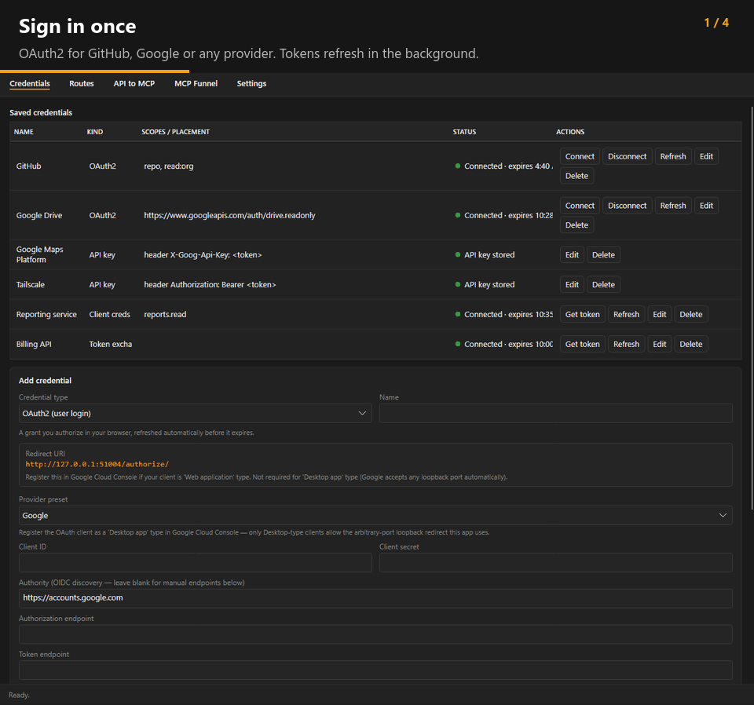

<p align="center">
  
</p>

<h1 align="center">RavensPort</h1>

<p align="center">
  <b>A local MCP gateway: give each AI agent its own MCP endpoint, choose exactly which tools it
  sees, turn any REST API or OpenAPI spec into MCP tools, and let RavensPort handle the OAuth.</b>
</p>

<p align="center">
  <a href="https://github.com/abishekvupputur/ravensPort/actions/workflows/coverage.yml"></a>
  <a href="https://sonarcloud.io/summary/new_code?id=abishekvupputur_ravensPort"></a>
  <a href="https://sonarcloud.io/summary/new_code?id=abishekvupputur_ravensPort"></a>
  <a href="../../releases"></a>
  <a href="LICENSE"></a>
</p>

<p align="center">
  <code>winget install RavensPort</code>
</p>

<p align="center">
  <a href="https://github.com/abishekvupputur/ravensPort/wiki"><b>Documentation</b></a>
  &nbsp;·&nbsp;
  <a href="https://apps.microsoft.com/detail/9PBNQH53L61D"><b>Microsoft Store</b></a>
  &nbsp;·&nbsp;
  <a href="../../releases"><b>Releases</b></a>
</p>

<p align="center">
  <sub>winget and the installer give you the full app. The Store build has no Proton Pass and no
  mTLS — <a href="https://github.com/abishekvupputur/ravensPort/wiki/Installation#from-the-microsoft-store">why</a>.</sub>
</p>

RavensPort is an MCP proxy that lives in your tray and listens on `127.0.0.1`. Point Claude Code,
Cursor, VS Code or any other MCP client at it, and each agent gets one endpoint carrying exactly
the tools you granted, from as many MCP servers and APIs as you like. Windows is the supported
platform; an experimental Debian/Ubuntu build is available for x86-64 and arm64.



## Why

- **Too many tools.** Connect three MCP servers and your agent sees all ninety of their tools,
  crowding its context. RavensPort lets you say "this agent gets these six".
- **OAuth everywhere.** More and more MCP servers sit behind OAuth2, but most clients expect a
  plain HTTP endpoint. RavensPort signs in once, refreshes the tokens, and no token ever goes in
  your `mcp.json`.
- **No MCP server at all.** The system you want the agent to reach often has only a REST API.
  RavensPort turns that API into MCP tools without you writing an MCP server.

## What it does

- **MCP Funnel** — an MCP gateway that pools several MCP servers behind one endpoint per agent,
  with per-tool filtering of tools, resources and prompts
- **API to MCP** — turn a REST API you already proxy into an MCP server from a JSON manifest, or
  import an OpenAPI (Swagger) spec and pick which of its operations become tools
- **OAuth2, handled** — Google, GitHub, Nextcloud or any custom provider; device-code sign-in;
  client-credentials and Google service accounts for logins with nobody at the keyboard; static
  API keys for the services that never offered OAuth. Tokens refresh in the background
- **Secrets stay in your password manager** — 1Password or Proton Pass holds every credential,
  and nothing is written to this PC
- **A proxy key per endpoint** — every route, funnel and bridge has its own, so a key leaked from
  one client cannot reach the rest. Optionally require a client certificate as well

## Install

```powershell
winget install RavensPort
```

Or take the installer from [Releases](../../releases), or the
[Microsoft Store](https://apps.microsoft.com/detail/9PBNQH53L61D). Windows 10/11. Full
instructions, including building from source, are in
[Installation](https://github.com/abishekvupputur/ravensPort/wiki/Installation).

### Debian / Ubuntu <sub>experimental</sub>

v5.0.0 moved the interface to Avalonia and added a `.deb` for Debian and Ubuntu. Since v5.0.1 there
is one for x86-64 (`amd64`) and one for 64-bit Arm (`arm64`, which covers a Raspberry Pi running
64-bit Raspberry Pi OS), and apt picks the right one. Install it from the RavensPort apt
repository, and `apt upgrade` keeps it current:

```bash
sudo install -d -m 0755 /etc/apt/keyrings
curl -fsSL https://abishekvupputur.github.io/ravensPort/apt/ravensport.asc \
  | sudo tee /etc/apt/keyrings/ravensport.asc > /dev/null
echo "deb [signed-by=/etc/apt/keyrings/ravensport.asc] https://abishekvupputur.github.io/ravensPort/apt ./" \
  | sudo tee /etc/apt/sources.list.d/ravensport.list
sudo apt update
sudo apt install ravensport
```

Or take the `.deb` from [Releases](../../releases) and `sudo apt install ./ravensport_<version>_<amd64|arm64>.deb`,
or build one from a checkout with `packaging/build-deb.sh`.

It has had far less use than the Windows build, and a few things differ by necessity — the Proton
Pass session key lives in the desktop keyring rather than behind Windows Hello, and `pass-cli` must
be installed in a system location. Everything is on the wiki:
**[Linux build](https://github.com/abishekvupputur/ravensPort/wiki/Linux-build)**.

## Documentation

Everything lives in the **[wiki](https://github.com/abishekvupputur/ravensPort/wiki)**.

| Page | |
|---|---|
| [Concepts](https://github.com/abishekvupputur/ravensPort/wiki/Concepts) | How credentials, routes, funnels and bridges fit together |
| [Setting up a credential](https://github.com/abishekvupputur/ravensPort/wiki/Credentials) | Every sign-in method, and how to test one |
| [Setting up a route](https://github.com/abishekvupputur/ravensPort/wiki/Routes) | Proxying an upstream, and choosing how the credential is sent |
| [API to MCP](https://github.com/abishekvupputur/ravensPort/wiki/API-to-MCP) | Manifests, variants, and importing an OpenAPI document |
| [MCP Funnel](https://github.com/abishekvupputur/ravensPort/wiki/MCP-Funnel) | Pooling sources into one endpoint and filtering what it exposes |
| [Calling the proxy](https://github.com/abishekvupputur/ravensPort/wiki/Calling-the-proxy) | Proxy keys, how long they last, and why there is one per endpoint |
| [Client certificates (mTLS)](https://github.com/abishekvupputur/ravensPort/wiki/Client-certificates) | Requiring a certificate as well as a key |
| [Where your configuration lives](https://github.com/abishekvupputur/ravensPort/wiki/Configuration-and-storage) | What is in the vault, what is on disk, and what syncs |
| [Logs](https://github.com/abishekvupputur/ravensPort/wiki/Logs) | What is recorded, what is redacted, and where it goes |
| [Troubleshooting](https://github.com/abishekvupputur/ravensPort/wiki/Troubleshooting) | When something does not work |
| [Building](https://github.com/abishekvupputur/ravensPort/wiki/Building) | Building, testing and packaging from source |
| [Linux build](https://github.com/abishekvupputur/ravensPort/wiki/Linux-build) | Building, installing and running the experimental Debian/Ubuntu package |

Manifests ready to use are in [`templates/api-mcp/`](templates/api-mcp/), and the format is
documented in [AUTHORING.md](templates/api-mcp/AUTHORING.md).

## License

MIT — see [LICENSE](LICENSE). Third-party dependencies (all MIT or Apache-2.0) are listed in
[THIRD-PARTY-NOTICES.md](THIRD-PARTY-NOTICES.md), which also covers what redistributing the
published exe requires.
