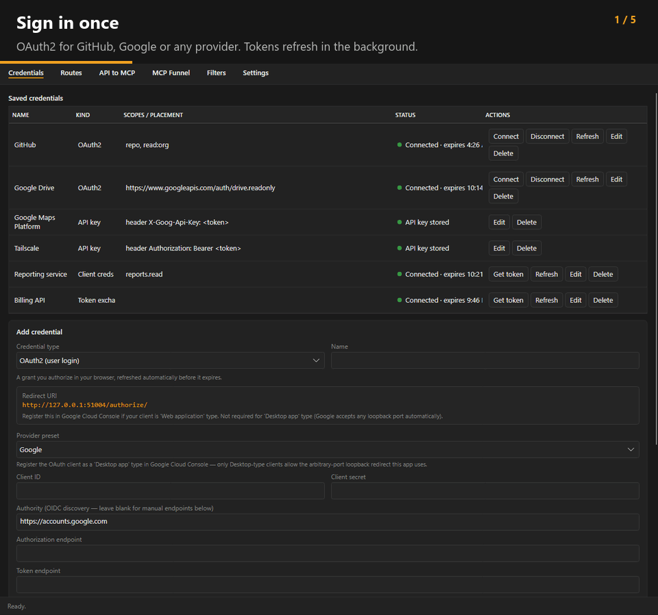
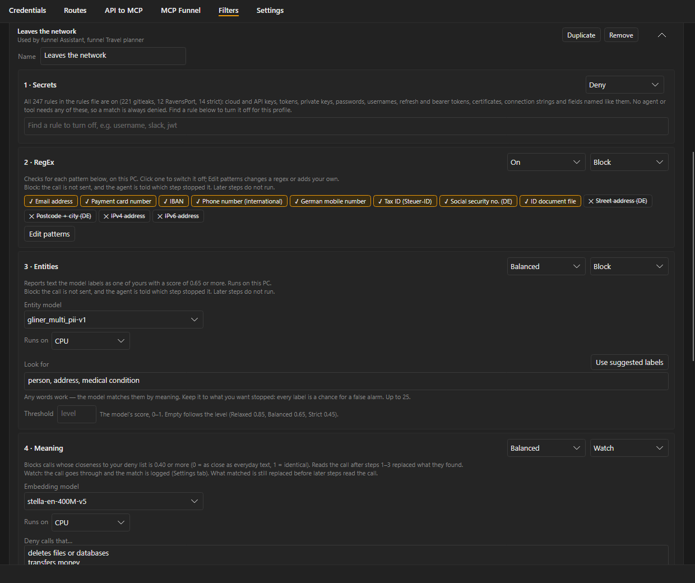

<p align="center">
  
</p>

<h1 align="center">RavensPort</h1>

<p align="center">
  <b>A local MCP gateway: give each AI agent its own MCP endpoint, choose exactly which tools it
  sees, check every call for secrets, personal data and risky actions before it leaves your PC,
  turn any REST API or OpenAPI spec into MCP tools, and let RavensPort handle the OAuth.</b>
</p>

<p align="center">
  <a href="https://github.com/abishekvupputur/ravensPort/actions/workflows/coverage.yml"></a>
  <a href="https://sonarcloud.io/summary/new_code?id=abishekvupputur_ravensPort"></a>
  <a href="https://sonarcloud.io/summary/new_code?id=abishekvupputur_ravensPort"></a>
  <a href="../../releases"></a>
  <a href="LICENSE"></a>
</p>

<p align="center">
  <code>winget install RavensPort</code>
</p>

<p align="center">
  <a href="https://github.com/abishekvupputur/ravensPort/wiki"><b>Documentation</b></a>
  &nbsp;·&nbsp;
  <a href="https://apps.microsoft.com/detail/9PBNQH53L61D"><b>Microsoft Store</b></a>
  &nbsp;·&nbsp;
  <a href="../../releases"><b>Releases</b></a>
</p>

<p align="center">
  <sub>winget and the installer give you the full app. The Store build has no Proton Pass and no
  mTLS — <a href="https://github.com/abishekvupputur/ravensPort/wiki/Installation#from-the-microsoft-store">why</a>.</sub>
</p>

RavensPort is an MCP proxy that lives in your tray and listens on `127.0.0.1`. Point Claude Code,
Cursor, VS Code or any other MCP client at it, and each agent gets one endpoint carrying exactly
the tools you granted, from as many MCP servers and APIs as you like. Windows is the supported
platform; an experimental Debian/Ubuntu build is available for x86-64 and arm64.



## Why

- **Too many tools.** Connect three MCP servers and your agent sees all ninety of their tools,
  crowding its context. RavensPort lets you say "this agent gets these six".
- **OAuth everywhere.** More and more MCP servers sit behind OAuth2, but most clients expect a
  plain HTTP endpoint. RavensPort signs in once, refreshes the tokens, and no token ever goes in
  your `mcp.json`.
- **No MCP server at all.** The system you want the agent to reach often has only a REST API.
  RavensPort turns that API into MCP tools without you writing an MCP server.
- **No say over what leaves.** An agent can paste a key, a customer's address or a
  `DROP TABLE` into any call. RavensPort checks every call before any server sees it, on your PC.

## What it does

- **MCP Funnel** — an MCP gateway that pools several MCP servers behind one endpoint per agent,
  with per-tool filtering of tools, resources and prompts
- **Call filters** — per agent, five steps check what goes out before any server sees it:
  secrets (the gitleaks rule set, always denied), personal data by editable patterns, personal
  data by a local entity model (GLiNER), meaning by an embedding model (local ONNX on CPU or
  GPU, Ollama, llama.cpp, OpenAI or Voyage AI), and your own statements answered with a
  probability by a decision model (TypeSafe Jev, Laya, or any zero-shot / cross-encoder ONNX
  model on CPU or GPU). Each step's matches are replaced before the next reads the call; matched
  values are never logged. Set up as profiles and chosen per route, bridge, funnel or upstream
  ([how](https://github.com/abishekvupputur/ravensPort/wiki/Call-filters))

  
- **API to MCP** — turn a REST API you already proxy into an MCP server from a JSON manifest, or
  import an OpenAPI (Swagger) spec and pick which of its operations become tools
- **OAuth2, handled** — Google, GitHub, Nextcloud or any custom provider; device-code sign-in;
  client-credentials and Google service accounts for logins with nobody at the keyboard; static
  API keys for the services that never offered OAuth. Tokens refresh in the background
- **Secrets stay in your password manager** — 1Password or Proton Pass holds every credential,
  and nothing is written to this PC
- **A proxy key per endpoint** — every route, funnel and bridge has its own, so a key leaked from
  one client cannot reach the rest. Optionally require a client certificate as well

## Safety approach

AI agents act through tools, and some actions can't be undone: deleting data, sending money,
pushing to production, leaking a key. RavensPort sits between the agent and every server it
reaches. It limits what each agent *can* do, keeps credentials out of the agent's hands, and checks
what each call *says* before any server sees it. The layers stack, so one failing does not open
everything.

**1. Each agent gets only the tools you allow (least privilege).**
- Each agent has its own endpoint. **Include** is a closed list: a tool you don't tick doesn't
  exist for that agent, and an empty list exposes nothing.
- Enforced on the call path, not just the tool list. A tool the agent saw before you unticked it,
  or simply guessed, is refused and never reaches the server. Edits apply on the next call.
- The surest way to prevent an irreversible action is not to offer the tool. The shipped
  templates are read-only where it matters ([`google-drive-readonly`](templates/api-mcp/google-drive-readonly.json),
  [`tailscale-readonly`](templates/api-mcp/tailscale-readonly.json)), and an OpenAPI import only
  turns into tools the operations you pick.

**2. Agents never hold the credentials.**
- RavensPort signs in and attaches the token or API key itself. The agent gets only a **proxy key
  for its own endpoint**: one key opens one endpoint and nothing else. It can expire, and
  regenerating it revokes the old one at once. Optionally a client certificate (mTLS) is required as
  well.
- Secrets live in 1Password or Proton Pass, not on disk.
- The forwarding path can't be turned against the credential. Redirects are refused rather than
  followed, a manifest can't set `Authorization` or `Cookie`, tool paths can't leave their route,
  and requests looping through the proxy are refused.

**3. Every call is checked before it leaves ([call filters](https://github.com/abishekvupputur/ravensPort/wiki/Call-filters)).**
Five steps, chosen per endpoint as a profile:

| Step | What it catches | How |
|---|---|---|
| 1 Secrets | API keys, tokens, passwords, private keys, connection strings | 247 rules (gitleaks plus stricter ones), always denied |
| 2 RegEx | Emails, card numbers, IBANs, phone numbers, tax IDs | Patterns with checksums |
| 3 Entities | Names, addresses, medical conditions | A local GLiNER model |
| 4 Meaning | Calls close to what you deny ("delete files or whole disks") | An embedding model, taught by deny and allow examples |
| 5 Decision | Your rules in plain words ("This text is about sending money.") | A zero-shot or Laya model returns a probability |

- A Block stops the call before any server sees it, and the agent is told which step stopped it.
  **Watch** only logs, so a rule can be tried before it is enforced.
- Steps 4–5 never see what steps 1–3 found: a match there either stops the call or is replaced
  first.
- A missing profile, a broken pattern, or a failed model on a Block step blocks the call (fails
  closed). Everything can run on this PC.

**4. Everything is on record.** The activity log records each call, refusal and filter match, with
the step and field that matched, but never the matched value or the call's arguments.

## Evidence

- **Demo:** the [tour](media/tour.gif) above, and [screenshots](media/) of every tab. The Filters
  tab's **Try it** shows each step's verdict and score for a call you paste in.
- **Tests:** about 1,400 core tests and 120 UI tests run on every pull request. A system suite
  runs against a real 1Password vault. Coverage and quality are tracked on
  [SonarCloud](https://sonarcloud.io/summary/new_code?id=abishekvupputur_ravensPort). The safety
  claims above each have tests, for example:

  | Claim | Tests |
  |---|---|
  | An unticked tool is refused on the call path | [`McpFunnelIsolationTests`](tests/RavensPort.Core.Tests/Mcp/McpFunnelIsolationTests.cs): `FilteringHolds_WhenBothEndpointsAreHammeredAtOnce`; [`McpFunnelSelectionTests`](tests/RavensPort.Core.Tests/Mcp/McpFunnelSelectionTests.cs): `IncludeIsAClosedList`, `AnEmptyIncludeListExposesNothing` |
  | One key opens one endpoint; revoking is immediate | [`McpApiBridgeKeyIsolationTests`](tests/RavensPort.Core.Tests/Mcp/McpApiBridgeKeyIsolationTests.cs): `OnlyTheBridgesOwnKeyOpensIt`, `RegeneratingTheKeyRevokesTheOldOneImmediately`, `AnExpiredKeyStopsOpeningTheEndpoint` |
  | Redirects don't carry the credential away | [`McpApiBridgeEndToEndTests`](tests/RavensPort.Core.Tests/Mcp/McpApiBridgeEndToEndTests.cs): `ARedirectIsRefusedRatherThanFollowedWithoutTheCredential` |
  | A blocked call never reaches the server | [`McpFunnelFilterTests`](tests/RavensPort.Core.Tests/Mcp/McpFunnelFilterTests.cs): `ABlockedCall_NeverReachesTheSource_AndSaysWhy`; [`EndpointFilterTests`](tests/RavensPort.Core.Tests/Mcp/EndpointFilterTests.cs): `ARouteWithAProfile_RefusesARequestCarryingAPassword_AndForwardsACleanOne` |
  | Filters fail closed | `AProfileDeletedUnderneath_BlocksTheCall`, `ARouteWhoseProfileIsGone_RefusesRatherThanForwarding`, [`FilterServiceTests`](tests/RavensPort.Core.Tests/Filters/FilterServiceTests.cs): `AnEntityModelThatFails_ReportsTheCallRatherThanWavingItThrough` |
  | Personal data found by steps 1–3 doesn't reach steps 4–5 | `FilterServiceTests`: `Entities_EveryOccurrenceIsReplacedForStep4_EvenOneTheModelReadAcrossAPlaceholder` |

- **Measured with real models, through RavensPort's own code:** the zero-shot model
  `deberta-v3-base-zeroshot-v2.0` (CPU, about 50 ms per call for three statements) scored
  `rm -rf …` 1.00, a money transfer 1.00 and `DROP TABLE` 0.70, and a weather lookup, `git status`
  and a file listing 0.00. The embedding model stella-en-400M-v5 scored a paraphrase of a denied
  action 0.91 and an unrelated text 0.28, in about 70 ms.
- **Supply chain:** CodeQL, SonarCloud, gitleaks, DevSkim, Trivy, OSV-Scanner, Snyk, zizmor and
  dependency review run in CI, and the installer is scanned. Every release carries a
  build-provenance attestation (`gh attestation verify`).
- **Documentation:** the [wiki](https://github.com/abishekvupputur/ravensPort/wiki), including
  [Call filters](https://github.com/abishekvupputur/ravensPort/wiki/Call-filters) and
  [Setting up filter models](https://github.com/abishekvupputur/ravensPort/wiki/Filter-models).

## Limitations

- **Not a sandbox.** RavensPort governs only what an agent sends through it. An agent with its own
  shell, network access or local (stdio) MCP servers can go around it, and RavensPort can't protect
  against a process that already controls your user account. Local stdio MCP servers can't be
  pooled at all.
- **Outgoing calls only.** What a tool returns isn't checked, so instructions hidden in a web page
  or a document (prompt injection) reach the agent unfiltered.
- **No human approval yet.** A step blocks or logs; there is no "ask me first" for a risky call.
- **Each call is judged on its own.** A harmful action split across several harmless-looking calls
  isn't recognised.
- **Detectors make mistakes.** Rules and models miss some things and flag some harmless ones.
  Steps 4–5 depend on how statements and examples are worded, and most of the suggested models are
  English. A Watch step whose model fails lets the call through, with the failure logged.
- **Remote models see call text.** If step 4 or 5 uses an API rather than a local model, that API
  receives every call it checks, minus what steps 1–3 replaced.
- **Setup effort.** No model ships with the app; you download and add them yourself. RavensPort's
  Laya runner hasn't yet been checked against Laya's reference outputs.
- **Platforms.** Windows is the supported platform. The Linux build is experimental and runs models
  on the CPU only.

## Install

```powershell
winget install RavensPort
```

Or take the installer from [Releases](../../releases), or the
[Microsoft Store](https://apps.microsoft.com/detail/9PBNQH53L61D). Windows 10/11. Full
instructions, including building from source, are in
[Installation](https://github.com/abishekvupputur/ravensPort/wiki/Installation).

### Debian / Ubuntu <sub>experimental</sub>

v5.0.0 moved the interface to Avalonia and added a `.deb` for Debian and Ubuntu. Since v5.0.1 there
is one for x86-64 (`amd64`) and one for 64-bit Arm (`arm64`, which covers a Raspberry Pi running
64-bit Raspberry Pi OS), and apt picks the right one. Install it from the RavensPort apt
repository, and `apt upgrade` keeps it current:

```bash
sudo install -d -m 0755 /etc/apt/keyrings
curl -fsSL https://abishekvupputur.github.io/ravensPort/apt/ravensport.asc \
  | sudo tee /etc/apt/keyrings/ravensport.asc > /dev/null
echo "deb [signed-by=/etc/apt/keyrings/ravensport.asc] https://abishekvupputur.github.io/ravensPort/apt ./" \
  | sudo tee /etc/apt/sources.list.d/ravensport.list
sudo apt update
sudo apt install ravensport
```

Or take the `.deb` from [Releases](../../releases) and `sudo apt install ./ravensport_<version>_<amd64|arm64>.deb`,
or build one from a checkout with `packaging/build-deb.sh`.

It has had far less use than the Windows build, and a few things differ by necessity — the Proton
Pass session key lives in the desktop keyring rather than behind Windows Hello, and `pass-cli` must
be installed in a system location. Everything is on the wiki:
**[Linux build](https://github.com/abishekvupputur/ravensPort/wiki/Linux-build)**.

## Documentation

Everything lives in the **[wiki](https://github.com/abishekvupputur/ravensPort/wiki)**.

| Page | |
|---|---|
| [Concepts](https://github.com/abishekvupputur/ravensPort/wiki/Concepts) | How credentials, routes, funnels and bridges fit together |
| [Setting up a credential](https://github.com/abishekvupputur/ravensPort/wiki/Credentials) | Every sign-in method, and how to test one |
| [Setting up a route](https://github.com/abishekvupputur/ravensPort/wiki/Routes) | Proxying an upstream, and choosing how the credential is sent |
| [API to MCP](https://github.com/abishekvupputur/ravensPort/wiki/API-to-MCP) | Manifests, variants, and importing an OpenAPI document |
| [MCP Funnel](https://github.com/abishekvupputur/ravensPort/wiki/MCP-Funnel) | Pooling sources into one endpoint and filtering what it exposes |
| [Call filters](https://github.com/abishekvupputur/ravensPort/wiki/Call-filters) | Profiles, the five steps, models on CPU or GPU, and the secret rules |
| [Calling the proxy](https://github.com/abishekvupputur/ravensPort/wiki/Calling-the-proxy) | Proxy keys, how long they last, and why there is one per endpoint |
| [Client certificates (mTLS)](https://github.com/abishekvupputur/ravensPort/wiki/Client-certificates) | Requiring a certificate as well as a key |
| [Where your configuration lives](https://github.com/abishekvupputur/ravensPort/wiki/Configuration-and-storage) | What is in the vault, what is on disk, and what syncs |
| [Logs](https://github.com/abishekvupputur/ravensPort/wiki/Logs) | What is recorded, what is redacted, and where it goes |
| [Troubleshooting](https://github.com/abishekvupputur/ravensPort/wiki/Troubleshooting) | When something does not work |
| [Building](https://github.com/abishekvupputur/ravensPort/wiki/Building) | Building, testing and packaging from source |
| [Linux build](https://github.com/abishekvupputur/ravensPort/wiki/Linux-build) | Building, installing and running the experimental Debian/Ubuntu package |

Manifests ready to use are in [`templates/api-mcp/`](templates/api-mcp/), and the format is
documented in [AUTHORING.md](templates/api-mcp/AUTHORING.md).

## License

MIT — see [LICENSE](LICENSE). Third-party dependencies (all MIT or Apache-2.0) are listed in
[THIRD-PARTY-NOTICES.md](THIRD-PARTY-NOTICES.md), which also covers what redistributing the
published exe requires.
